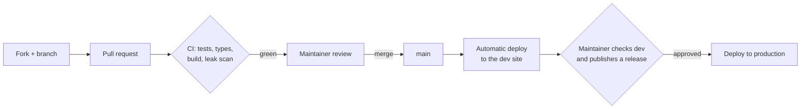

# Contributing to BCR32 Studio

Thanks for helping. BCR32 Studio is a browser editor for the Behringer BCR32 MIDI controller. Contributions of code,
translations, tests, documentation and **protocol observations from real hardware** are all welcome.

## How a change reaches users



1. Fork the repository and create a branch from `main`.
2. Make your change with tests, run `npm test` locally.
3. Open a pull request. CI runs the tests, the type check, the build and a generic leak scan. Pull requests from forks
   run without any secret.
4. The maintainer reviews (every path is owned by the maintainer, see `.github/CODEOWNERS`) and merges.
5. Every merge to `main` is deployed automatically to the **development** site.
6. After checking the development site, the maintainer publishes a GitHub release; the **production** deployment then
   waits for the maintainer's approval of the `production` environment. See [docs/DEPLOYMENT.md](docs/DEPLOYMENT.md).

## Development setup

Requirements: Node.js 22, a Chromium-based browser (Web MIDI with SysEx), optionally a BCR32 on USB.

```sh
npm ci
npm run dev        # http://127.0.0.1:5173/
npm test           # every scripts/test-* suite, then tsc
npm run build      # production build in dist/
```

`npm run midi -- ports|probe|monitor` is a small command-line tool to list ports, send the read-only product query and
log incoming MIDI with millisecond timestamps.

## Rules that protect users' hardware

The BCR32 protocol is only partly known. A wrong write can corrupt a preset or worse.

- Never add code that sends **STORE (`0x72`)** or anything of the **bootloader / firmware update (`0x77`)** family. A
  test fails the build if the bundle contains them.
- Do not add a SysEx **write** that has not been verified on hardware and documented in
  [docs/PROTOCOL.md](docs/PROTOCOL.md), with the capture that proves it.
- Do not "scan" unknown commands on a device. Observation of the device's own traffic is the preferred method.
- The app sends MIDI **values** (CC, NRPN, notes) in response to UI gestures; this is enabled automatically when a
  BCR32 is detected and can be switched off. It never changes the device's assignments.

## Code conventions

- TypeScript strict, React function components, no new runtime dependency without discussion.
- Code, comments and UI source strings are in **English**. Every UI string has a row in the i18n catalog
  (`src/i18n.tsx`, `src/i18n-status.ts`) with all eight languages: en, fr, it, de, ja, es, ru, zh. If you cannot
  translate a language, copy the English text and say so in the pull request.
- Tests are plain Node scripts in `scripts/test-*.mjs`; prefer rendered checks (react-dom/server) and behaviour checks
  over source-text checks.
- Keep pull requests focused: one feature or fix per pull request.

## Protocol findings

Open an issue with the "Hardware capture" template: what you did on the device, the hex messages in both directions,
the firmware version, and how you captured them. Remove personal data (paths, names, serial numbers) first.

## Privacy

Do not commit logs, screenshots or files that contain personal data. Maintainers run `scripts/leak-gate.mjs` before
pushing; CI runs its generic rules on every pull request.

## License

By contributing you agree that your contribution is licensed under the [MIT License](LICENSE).
