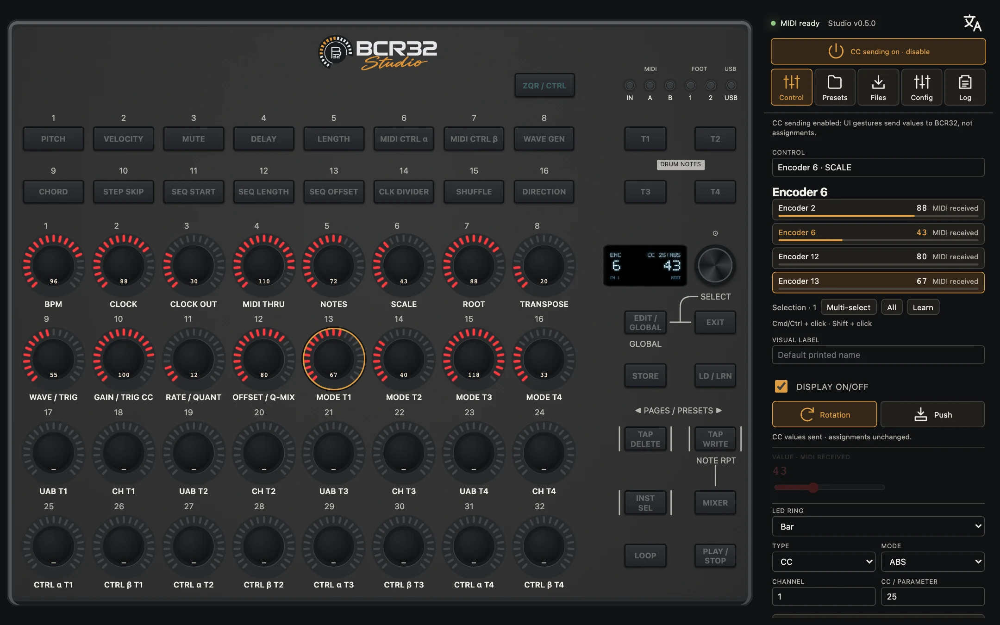

# BCR32 Studio

A browser editor for the **Behringer BCR32** MIDI controller: see what the controller sends, design presets, print
overlay sheets and export a ready-made Cubase surface. It runs entirely in the browser through Web MIDI. Nothing to
install, no account, nothing leaves your machine.

Current version: **0.6.0** · [Changelog](CHANGELOG.md)

**Try it now: https://bcr32-studio.github.io/** (Chrome, Edge, Brave or Opera; plug in the BCR32 over USB
and allow MIDI access). Without a controller the editor still opens: presets, PDF sheets and the Cubase export work offline.



> BCR32 Studio is an independent community project. It is not affiliated with, endorsed or supported by Behringer or
> Music Tribe. "Behringer" and "BCR32" are trademarks of their owners, used here only to name the hardware this editor
> works with.

## Features

- **Interactive front panel**: 32 push encoders, programmable keys, LED rings and the OLED screen follow the MIDI the
  controller sends, live.
- **Assignments per control**: type (CC, NRPN, note, pitch bend, aftertouch, program change, GS/XG, MMC), channel,
  parameter, range, absolute / 14-bit / relative modes, button modes, LED ring mode, display on/off.
- **MIDI Learn**: select a control, press Learn, move the hardware control: its message fills the assignment.
- **OLED multiplexing**: when several encoders turn at once, the screen is shared in proportion to their pulses, in
  readable slots, and an activity strip lists the active controls.
- **Presets and banks**: JSON import/export, local library, A4 PDF overlay sheet with your labels.
- **Cubase export**: a MIDI Remote script (Cubase 12 and later) describing the surface and the exact MIDI of every
  assigned control; map functions in Cubase with its Mapping Assistant.
- **Eight languages**: English, French, Italian, German, Japanese, Spanish, Russian, Chinese.
- **LED brightness** read and write over SysEx (the only device setting written; verified on hardware).
- **Device settings** read from the controller (operating mode, output ports, thru, clock, scale…), read-only.

## What it does not do (yet)

Writing assignments to the controller's memory is **not** implemented: the SysEx needed is not fully understood, and
a wrong write can damage a preset. The editor only ever sends MIDI *values* (CC, NRPN, notes) when you move a control
in the UI; this is switched on automatically when a BCR32 is detected and can be turned off with the "CC sending" toggle. See
[docs/PROTOCOL.md](docs/PROTOCOL.md) for what is known and the open questions; captures from real hardware are the
most valuable contribution.

## Use it

- **Hosted**: https://bcr32-studio.github.io/, rebuilt from `main` on every merge.
- **Local**: `npm ci && npm run dev`, then http://127.0.0.1:5173/.

A Chromium-based browser is required: Web MIDI with SysEx is not available in Firefox or Safari. Everything stays in
your browser (local storage); there is no account and no server.

## Develop

```sh
npm ci
npm run dev        # http://127.0.0.1:5173/
npm test           # all test suites, then the TypeScript check
npm run build
```

Command-line helper: `npm run midi -- ports`, `npm run midi -- probe` (read-only product query),
`npm run midi -- monitor` (incoming MIDI with millisecond timestamps).

Stack: React 19, TypeScript (strict), Vite, Web MIDI, pdf-lib; deployed as static assets on Cloudflare Workers.

## Contribute

Pull requests are welcome: see [CONTRIBUTING.md](CONTRIBUTING.md). Merged changes go live on GitHub Pages automatically
([docs/DEPLOYMENT.md](docs/DEPLOYMENT.md)). Security issues:
[SECURITY.md](SECURITY.md).

## License

[MIT](LICENSE). The bundled Noto Sans font is under the SIL Open Font License (`public/fonts/NotoSans-LICENSE.txt`).
