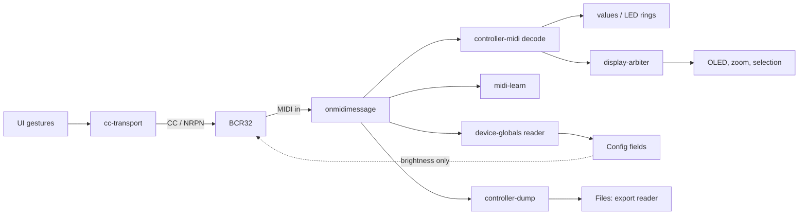

# Architecture

## Current standalone routing and sequencer extension (0.45.0-alpha.12)

The product site is `index.html` with isolated `site/` CSS/JavaScript and static artwork in `public/site/assets/`. The application entry is `editor/index.html` → `src/main.tsx`. The landing page does not import the editor or request Web MIDI. Vite builds both HTML entries; the same output supports a domain root or GitHub Pages project subpath. `deployment-base.ts` resolves public assets, documentation and the service worker from the project root, not the editor directory. The offline worker distinguishes the two HTML documents and never serves the landing page as an editor session.

The BCR32 module lives under `src/editors/bcontrol/bcr32/`. Its sequencer host extension is split into pure protocol (`zaq-host.ts`), view-local lifecycle (`useSequencerHost.ts`) and existing presentation (`SequencerView.tsx`). MIDI ports, ownership and authorizations remain in the shared host. The protocol client has no browser, React, storage or device-discovery dependency. Existing file codecs do not gain a general-purpose raw SysEx sender.

See [firmware 1.0.3 protocol, provenance and validation limits](BCR32-PROTOCOL-1.0.3.md). The source map below describes the inherited foundation; it is not evidence that historical paths or capabilities supersede the current module implementation.

## Inherited foundation

A static single-page application: React 19, TypeScript (strict), Vite, Web MIDI. No server, no backend, no runtime
dependency beyond React and pdf-lib. State lives in React state and the browser's local storage.

## Source map

| Area | Files | Role |
| --- | --- | --- |
| Shell | `main.tsx`, `App.tsx` | entry point; App owns the state, the MIDI wiring and the five tabs (Control, Presets, Files, Config, Log) |
| Panel | `FrontPanel.tsx`, `panel-layout.ts`, `OledDisplay.tsx`, `ActivityLeds.tsx`, `led-modes.ts` | front panel geometry (1717 × 1440 coordinate space), controls, LED rings, dot-matrix OLED and label screen, activity LEDs |
| Model | `profile.ts`, `presets.ts`, `multi-selection.ts`, `control-search.ts` | profile (encoders, pushes, keys, settings) with validation, presets and library files, multi-selection editing, search |
| MIDI | `web-midi.ts`, `auto-midi.ts`, `controller-midi.ts`, `cc-transport.ts`, `rotation.ts` | Web MIDI access, automatic BCR32 port pairing, decoding of incoming messages per assignment, rate-limited value sending |
| Device protocol | `led-brightness.ts`, `device-globals.ts`, `controller-dump.ts` | brightness read/write, global settings (reads; writes disabled), front-panel export decoding |
| Features | `midi-learn.ts`, `display-arbiter.ts`, `cubase-export.ts`, `preset-pdf.ts`, `parameter-names.ts`, `parameter-banks.ts` | MIDI Learn parser, OLED multiplexing, Cubase MIDI Remote script generator, PDF overlay, parameter-name tables |
| UI blocks | `StudioConfig.tsx`, `DeviceSettings.tsx`, `ExportImport.tsx`, `ParameterNames.tsx`, `ControlSearch.tsx`, `Icon.tsx` | Config sections, device settings table, export reader, parameter tables, search |
| Look | `styles.css`, `themes.ts`, `display-styles.ts` | styles, six themes, five screen styles (CSS variables) |
| Text | `i18n.tsx`, `i18n-status.ts` | catalog `en|fr|it|de|ja|es|ru|zh`, `translate()` and `translatedTree()` |

## Data flow

- Every incoming message goes through the same handler in `App.tsx`; each consumer ignores what is not for it.
- Pure modules (decoders, arbiter, learn parser, dump decoder, Cubase generator, global-settings reader) take
  injectable timers and senders, so they are tested without a browser.

## Device protocol in the code

- **Never** STORE (`0x72`) or bootloader (`0x77`): guarded in `device-globals.ts` and checked on the built bundle by
  `scripts/test-studio-config.mjs`.
- Global settings: `createGlobalsReader()` sends one short read at a time (`F0 00 20 32 7F 64 <cmd> F7`), reports
  value / echo / no reply; `globalWritesEnabled = false` blocks every write since a write froze a unit.
- Front-panel export: `decodeControllerDump()` checks the 273-byte container, nibbles and 16-bit checksum, splits
  11-byte records; `groupExports()` rebuilds a preset from its 8 blocks; `knownRecords` lists the records whose
  control is established on hardware (record 0 = encoder 1).
- Protocol facts and their confidence: [PROTOCOL.md](PROTOCOL.md).

## Internationalisation

UI strings are written in English in the code. `translatedTree()` translates the text and the `aria-label`, `title`
and `placeholder` of host elements in the App tree; components rendered inside it (`DeviceSettings`, `ExportImport`,
`StudioConfig`, `OledDisplay`…) translate their own strings with `translate(text, useLanguage())`. Slots `{name}`,
`{count}`, `{file}` are copied; `{detail}` is translated recursively. A new string needs a row with all eight
languages (`scripts/test-i18n.mjs` rejects duplicates and checks rendered translations).

## Storage keys (local storage)

| Key | Content |
| --- | --- |
| `bcr32-studio.draft.v1` | current state (profile, labels, values, ring mode); takes precedence over the profile at load |
| `bcr32-studio.profile.v1`, library and workspace keys | profile, preset library, current preset name |
| `bcr32-studio.parameter-names.v2` | parameter-name table |
| `bcr32-studio.language.v1`, theme key | language choice, theme |
| `bcr32-studio.auto-zoom`, `.show-numbers`, `.name-screen`, `.display-style`, `.device-autoload` | display and device options |

## Tests

`npm test` runs every `scripts/test-*.mjs` (plain Node, no browser), then `tsc -b --noEmit`. Tests load the TypeScript
sources with `ts.transpileModule` (which is why TypeScript 7 is held back) and prefer rendered checks with
`react-dom/server` plus behaviour checks with simulated clocks and devices. Browser end-to-end checks that need a
Chromium (`scripts/e2e-oled-multiplex.cjs`) are run by hand with `PLAYWRIGHT_CORE` pointing to a playwright-core
install; they inject a fake Web MIDI input and never touch a real device.

## Build and deployment

`vite.config.mts` builds with relative asset paths (`base: './'`) so one build serves a domain root or a sub-path;
`META_CSP=1` injects the Content-Security-Policy of `public/_headers` as a meta tag for GitHub Pages. Deployment:
[DEPLOYMENT.md](DEPLOYMENT.md). Leak scan: `scripts/leak-gate.mjs` (CI rules plus a maintainer's private denylist
kept outside the repository).

## Physical acceptance of background queries

A read operation may preserve preset bytes while still advancing an export cursor or blocking front-panel controls. BCR32 export08 polling failed this gate on2026-10-29 and was withdrawn. New background queries must prove that mode keys and normal controls remain available during sustained monitoring, including transfer boundaries and background-browser operation. Valid checksums, fake-MIDI tests and unchanged stored data do not establish this property. Unknown or failing queries remain outside the host grant and must not be retried in a loop as a status mechanism.
